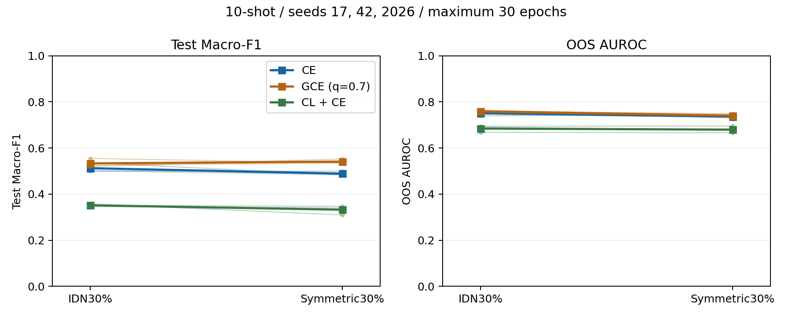

# 10-shot、30%噪声的两类条件比较

沿用v2配置，每类条件各三个种子。本表为描述性比较，不替代正式统计检验。

| 方法 | IDN Macro-F1 | 对称噪声 Macro-F1 | 对称−IDN配对均值 |
| --- | --- | --- | --- |
| 干净CE | 0.7012±0.0117 | 0.7012±0.0117 | +0.0000 |
| 带噪CE | 0.5123±0.0206 | 0.4887±0.0090 | -0.0236 |
| GCE(q=0.7) | 0.5331±0.0188 | 0.5409±0.0102 | +0.0078 |
| 清洗后CE | 0.3515±0.0059 | 0.3322±0.0201 | -0.0192 |

误差项为种子间样本标准差，非置信区间。两类噪声使用相同干净子集、模型与预算，但噪声选择和目标标签采用不同随机命名空间，翻转集合不相同；不能将分数差单独归因于语义相似性。

三个干净CE参考在本轮重新训练，逐样本预测与上一轮逐字节一致。该检查只覆盖干净参考，不代表所有带噪模型重复训练均已验证。

图中每条细线表示同一方法、同一种子在两种条件下的结果，粗线表示三种子均值。完整逐种子差值和OOS AUROC比较见同名JSON。清洗诊断和各自成本见两组正式结果报告。
