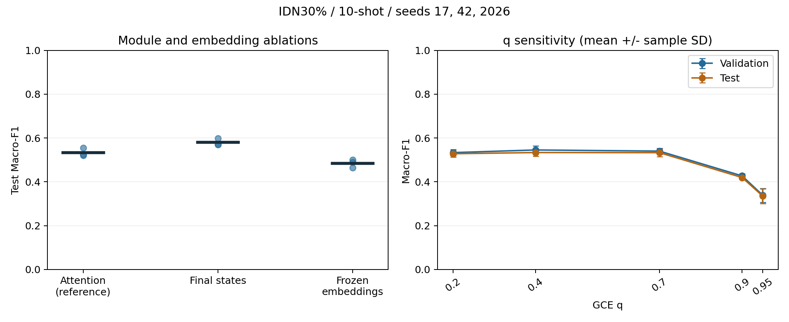

# IDN30%、10-shot 三组消融结果

2026-11-17。种子17/42/2026，30轮上限、耐心5、验证宏F1选模。设置见[消融协议](消融实验协议.md)，命令见[运行说明](消融实验运行说明.md)。

新增18次训练；完整q=0.7参考复用上一阶段三种子，不计为本轮新训练。

| 设置 | 最佳验证Macro-F1 | 测试Macro-F1 | Accuracy | OOS AUROC | 相对参考F1差值 |
| --- | --- | --- | --- | --- | --- |
| 注意力+可微调嵌入，q=0.7（已有参考） | 0.5401±0.0138 | 0.5331±0.0188 | 0.5416±0.0192 | 0.7589±0.0053 | — |
| 末状态汇聚，q=0.7 | 0.5816±0.0059 | 0.5795±0.0160 | 0.5910±0.0150 | 0.7770±0.0109 | +0.0464 |
| 冻结嵌入，q=0.7 | 0.4864±0.0099 | 0.4850±0.0192 | 0.4970±0.0156 | 0.7329±0.0084 | -0.0481 |
| q=0.2 | 0.5333±0.0135 | 0.5281±0.0146 | 0.5362±0.0150 | 0.7536±0.0082 | -0.0050 |
| q=0.4 | 0.5454±0.0183 | 0.5337±0.0161 | 0.5417±0.0153 | 0.7585±0.0066 | +0.0006 |
| q=0.9 | 0.4271±0.0101 | 0.4196±0.0074 | 0.4621±0.0049 | 0.7301±0.0047 | -0.1135 |
| q=0.95 | 0.3388±0.0316 | 0.3350±0.0336 | 0.3979±0.0243 | 0.7091±0.0125 | -0.1981 |

表中为三种子均值±样本标准差。差值先按种子配对，再取均值；不是显著性检验。q=0.7仍为固定主参数，其他q仅作敏感性检查，不根据测试排名改写主配置。

## 模块与嵌入

末状态汇聚相对注意力参考的平均测试F1差值为 +0.0464；冻结嵌入的差值为 -0.0481。
移除注意力会改变参数量及初始化随机数消耗，同一种子不代表所有共享层初始参数逐项相同。实际训练轮数也可能因早停不同，当前结果只适用于本组数据、模型和训练规则，不能概括为注意力或微调在所有条件下无效。

三个冻结嵌入的最佳模型都与初始嵌入矩阵逐项一致；导出初始/最佳矩阵供独立检查。其他分类参数仍参与学习。

## q敏感性

图中同时保留验证与测试表现。q较大时GCE对低目标类概率样本的梯度较小；固定有限预算下的差异可能同时反映收敛速度与噪声鲁棒性，当前实验不能单独分离二者。

## 成本与训练过程

| 设置 | seed | 最佳/完成轮数 | 参数量 | 更新次数 | 训练含验证/秒 | 路线墙钟/秒 |
| --- | --- | --- | --- | --- | --- | --- |
| 末状态汇聚，q=0.7 | 17 | 27/30 | 450770 | 720 | 18.04 | 29.89 |
| 末状态汇聚，q=0.7 | 42 | 25/30 | 451770 | 720 | 17.22 | 29.30 |
| 末状态汇聚，q=0.7 | 2026 | 30/30 | 450870 | 720 | 17.16 | 29.05 |
| 冻结嵌入，q=0.7 | 17 | 30/30 | 451026 | 720 | 21.22 | 32.98 |
| 冻结嵌入，q=0.7 | 42 | 30/30 | 452026 | 720 | 20.43 | 32.08 |
| 冻结嵌入，q=0.7 | 2026 | 30/30 | 451126 | 720 | 19.95 | 31.07 |
| q=0.2 | 17 | 29/30 | 451026 | 720 | 20.61 | 32.09 |
| q=0.2 | 42 | 19/24 | 452026 | 576 | 16.42 | 27.50 |
| q=0.2 | 2026 | 24/29 | 451126 | 696 | 22.01 | 33.35 |
| q=0.4 | 17 | 24/29 | 451026 | 696 | 20.23 | 31.56 |
| q=0.4 | 42 | 22/27 | 452026 | 648 | 18.72 | 30.01 |
| q=0.4 | 2026 | 21/26 | 451126 | 624 | 18.70 | 30.00 |
| q=0.9 | 17 | 30/30 | 451026 | 720 | 20.80 | 32.31 |
| q=0.9 | 42 | 29/30 | 452026 | 720 | 20.96 | 32.54 |
| q=0.9 | 2026 | 29/30 | 451126 | 720 | 21.48 | 32.80 |
| q=0.95 | 17 | 30/30 | 451026 | 720 | 21.45 | 32.82 |
| q=0.95 | 42 | 30/30 | 452026 | 720 | 21.58 | 33.34 |
| q=0.95 | 2026 | 30/30 | 451126 | 720 | 21.69 | 33.38 |

本轮顺序训练和评估墙钟共 566.30 秒，不含环境安装与下载。逐轮PyTorch已分配/保留显存随训练摘要保存，不是整卡占用。

## 验收范围

原始18组共99000条预测、配置快照、词表、日志、图表及冻结矩阵在 `reports/stage4/ablations_idn10_v2/`。独立核验重算指标，检查每项变更字段、同种子输入/验证指纹、运行环境和词表来源。

本轮完成模块、嵌入、q三个消融方向在一个条件下的检查；尚未完成清洗变体/取消OOF消融、其他样本量和噪声比例、完整配对统计、公开基线验收、最终报告与PPT。
