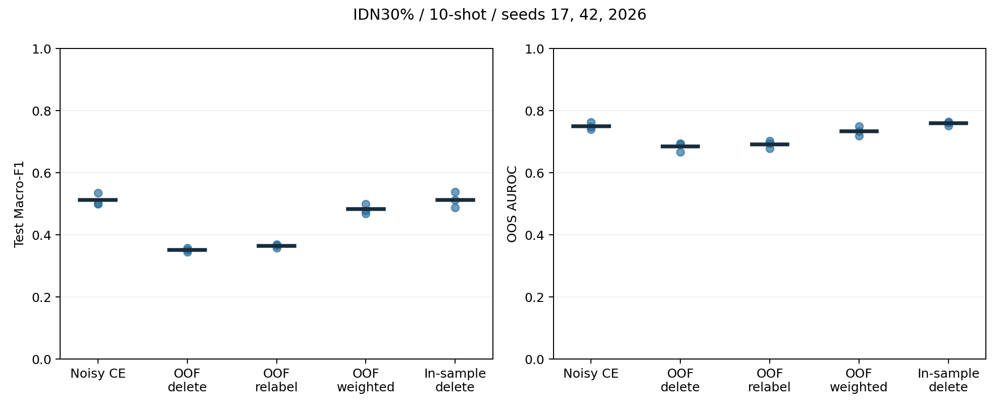

# IDN30%、10-shot 清洗变体结果

2026-11-17。三个种子17/42/2026，30轮上限、耐心5、验证宏F1选模。规则见[协议](清洗变体实验协议.md)，命令见[运行说明](清洗变体运行说明.md)。

| 路线 | 测试Macro-F1 | Accuracy | OOS AUROC | 相对CE的F1均值差 |
| --- | --- | --- | --- | --- |
| 带噪CE（已有参考） | 0.5123±0.0206 | 0.5191±0.0183 | 0.7504±0.0119 | +0.0000 |
| OOF删除（已有参考） | 0.3515±0.0059 | 0.3787±0.0092 | 0.6843±0.0145 | -0.1609 |
| CE重跑 | 0.5123±0.0206 | 0.5191±0.0183 | 0.7504±0.0119 | +0.0000 |
| OOF硬重标注 | 0.3646±0.0062 | 0.3716±0.0064 | 0.6917±0.0126 | -0.1477 |
| OOF概率加权 | 0.4827±0.0159 | 0.5005±0.0148 | 0.7339±0.0155 | -0.0296 |
| 训练内打分后删除 | 0.5128±0.0249 | 0.5205±0.0234 | 0.7595±0.0074 | +0.0005 |

均值±样本标准差；差值逐种子配对后求均值。三种子只作描述性比较，不宣布显著性或OOS非劣。三个CE重跑的预测文件与已有参考逐字节一致。

固定比较的配对区间与探索性Holm校正见[统一配对统计结果](配对统计结果.md)；统计限制仍由三种子规模决定。

## 重标注的事后诊断

以下只在全部训练完成后使用原始干净训练标签，不参与标记、权重或阈值选择。错标是人工注入的标签翻转，不是人工语义判定。

| seed | 改标数 | 修正的翻转样本 | 被改坏的原始干净样本 | 改标后仍错 | 缺失训练类数 |
| --- | --- | --- | --- | --- | --- |
| 17 | 862 | 180 | 443 | 713 | 0 |
| 42 | 850 | 179 | 423 | 694 | 0 |
| 2026 | 807 | 164 | 392 | 678 | 0 |

硬重标注后的平均错标比例为46.33%，原注入比例为30%。虽然修正了一部分翻转样本，同时把较多原始干净样本改成错误标签；这一结果不支持当前硬重标注规则有效。

## 删除方式与加权

| 来源 | seed | 保留样本 | 删掉翻转样本 | 删掉原始干净样本 | 保留翻转样本 |
| --- | --- | --- | --- | --- | --- |
| 训练内打分后删除 | 17 | 1495 | 5 | 0 | 445 |
| OOF删除（已有参考） | 17 | 638 | 419 | 443 | 31 |
| 训练内打分后删除 | 42 | 1497 | 3 | 0 | 447 |
| OOF删除（已有参考） | 42 | 650 | 427 | 423 | 23 |
| 训练内打分后删除 | 2026 | 1487 | 12 | 1 | 438 |
| OOF删除（已有参考） | 2026 | 693 | 415 | 392 | 35 |

| seed | 翻转样本平均权重 | 原始干净样本平均权重 | 加权后的翻转质量占比 | 有效样本量 |
| --- | --- | --- | --- | --- |
| 17 | 0.2450 | 1.3236 | 0.0735 | 639.3 |
| 42 | 0.2148 | 1.3365 | 0.0644 | 634.0 |
| 2026 | 0.2322 | 1.3290 | 0.0697 | 649.7 |

有效样本量为(Σw)²/Σw²，仅描述权重集中程度，不等于独立观测数量。加权后的翻转质量占比为翻转样本权重和除以全部权重和。

加权降低了翻转样本的总权重，但本组分类F1仍低于普通CE。说明降低该诊断量不能直接保证分类提升；权重同时降低了部分原始干净样本的贡献，当前实验未单独检验这些因素的因果作用。

训练内打分没有折外隔离，模型见过每个被打分样本；即使其后分类分数较高，也不能据此认定它比OOF更能无偏识别错标。其打分模型使用全部1500条训练，而OOF每折只用1200条，额外算力和训练样本量也不同。

删除会缩小训练集和词表并减少每轮更新；重标注/加权保留全部文本。处理方式、样本数量、词表及更新量同时变化，当前实验不能单独归因于某一个因素。

## 成本

| 路线 | seed | 样本数 | 最佳/完成轮数 | 更新数 | 最终训练含验证/秒 | 复用OOF训练/秒 | 共享训练内打分模型训练/秒 |
| --- | --- | --- | --- | --- | --- | --- | --- |
| CE重跑 | 17 | 1500 | 30/30 | 720 | 20.08 | 0.00 | 0.00 |
| CE重跑 | 42 | 1500 | 25/30 | 720 | 20.41 | 0.00 | 0.00 |
| CE重跑 | 2026 | 1500 | 23/28 | 672 | 23.07 | 0.00 | 0.00 |
| OOF硬重标注 | 17 | 1500 | 26/30 | 720 | 25.50 | 95.61 | 0.00 |
| OOF硬重标注 | 42 | 1500 | 21/26 | 624 | 17.50 | 115.71 | 0.00 |
| OOF硬重标注 | 2026 | 1500 | 23/28 | 672 | 19.16 | 105.96 | 0.00 |
| OOF概率加权 | 17 | 1500 | 30/30 | 720 | 22.15 | 95.61 | 0.00 |
| OOF概率加权 | 42 | 1500 | 28/30 | 720 | 21.57 | 115.71 | 0.00 |
| OOF概率加权 | 2026 | 1500 | 29/30 | 720 | 20.64 | 105.96 | 0.00 |
| 训练内打分后删除 | 17 | 1495 | 28/30 | 720 | 20.20 | 0.00 | 20.08 |
| 训练内打分后删除 | 42 | 1497 | 22/27 | 648 | 18.46 | 0.00 | 20.41 |
| 训练内打分后删除 | 2026 | 1487 | 22/27 | 648 | 18.71 | 0.00 | 23.07 |

本轮12次新训练和评估墙钟 392.04 秒。OOF概率复用上一阶段15次训练，表中成本为历史实测归属，不是本轮重新运行；重标注和加权各自完整执行都需这份OOF成本，但本轮共享资产不能重复累计为新增成本。
取消OOF路线需CE打分模型和最终重训，打分模型在CE重跑中共享。其训练内推理耗时、各路线墙钟及显存详见JSON；CE重跑墙钟还含独立测试/绘图，不能当作纯清洗成本。

## 验收与后续

12组共66000条预测、处理决策、词表、权重及训练内概率保存在 `reports/stage4/cleaning_variants_idn10_v2/`。核验独立重算指标，重放处理规则，重建训练哈希并核对权重对齐；概率来源的模型/训练哈希同时保存。

完整模型权重保留本地，结果核验不等于从模型重新生成概率或全新环境重训。后续仍需其他样本量/噪声比例、正式配对统计、公开基线验收及报告/PPT。
